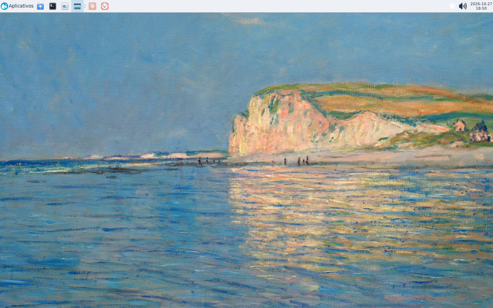

# xfce-wslg-toolkit

Xfce em uma janela Xephyr redimensionável sobre o WSLg, com GPU quando disponível, controles de monitor e integração de texto com a área de transferência do Windows. O alvo padrão é 144 Hz; isso **não é garantia de 144 FPS**.



## Começar

No Windows, prepare WSL2 + Ubuntu + WSLg e um driver gráfico compatível. No Ubuntu, como usuário normal, entre na cópia local deste repositório:

```bash
./install.sh --dry-run
./install.sh
# Abra outro Bash, ou recarregue os aliases:
source ~/.bash_aliases
xfce
```

O instalador instala dependências via apt, copia o runtime para `~/.local/share/xfce-wslg-toolkit`, cria comandos em `~/.local/bin` e configura a integração Windows, com helpers e atalhos opcionais. Leia [Instalação](docs/INSTALLATION.md) antes de executar; não rode o instalador inteiro com sudo.

## Comandos

| Comando | Função |
| --- | --- |
| `xfce` / `xfce144` | Abrir/apresentar uma única sessão em janela redimensionável; GPU se disponível; alvo de 144 Hz por padrão |
| `xfce status` | Consultar o estado da sessão |
| `xfce direita` / `xfce esquerda` | Apresentar em tela cheia no monitor à direita/esquerda |
| `xfce janela` | Voltar ao modo janela |
| `xfce-wsl-display left` / `right` / `window` | Controlar a janela de uma sessão já aberta |
| `xfce-wsl-display status` / `list` | Consultar janela e monitores detectados |
| `xfce-wsl-restore-cursor` | Tentar recuperar o ponteiro sem reiniciar o desktop |
| `xfce-wsl-run COMMAND` | Executar um programa no ambiente da sessão; exemplo: `xfce-wsl-run xfce4-terminal` |

Os aliases são para Bash; com `--no-alias`, use `~/.local/bin/xfce-wsl`. Controles de monitor não substituem o comando inicial de abertura.

## Escopo e limites

- Desktop X11 **aninhado em Xephyr sobre WSLg**, não uma sessão de login Windows/Linux. Sem display manager e sem alterar globalmente permissões dos sockets do WSLg.
- D-Bus e cookie X11 privados por sessão; configuração de GPU limitada ao ambiente da sessão, sem exports globais em `.bashrc`. Isso não transforma aplicativos X11 em uma sandbox de segurança.
- Clipboard bidirecional de **texto somente**: sem arquivos, imagens ou rich text. O helper nativo evita depender das notificações X selection perdidas no WSLg observado. Não registrar payloads do clipboard.
- RandR sintético do Xephyr pode mostrar **0 Hz**; não é a taxa física do monitor. Monitores físicos de 60/144 Hz podem coexistir, e o de 60 Hz não passa a exibir 144 quadros distintos. Meta de apresentação e FPS medido são coisas diferentes.
- Redimensionamento muda a área do desktop; escala HiDPI muda o tamanho de textos/elementos. Preserve os padrões de DPI do Windows.
- A correção de perfil atua no único monitor virtual raiz do Xephyr: `AutoEnableProfiles=0` evita restaurar um perfil antigo de `1600x1200` e a faixa preta associada. Não é uma política para monitores físicos.
- No build observado, `-output` em tela cheia derrubou o Xephyr; os controles usam EWMH. A visibilidade real do ponteiro precisa de confirmação do usuário.
- Não são distribuídos binários baixados nem wallpaper. Escolha uma imagem própria localmente, sem adicioná-la ao repositório.

## Evidência, não promessa

O pipeline original em uso foi comprovado em **Ubuntu 26.04.1, WSL 3.0.3, WSLg 1.0.79 e NVIDIA RTX 3060 via D3D12**. Isso é evidência do ambiente original, não de uma instalação limpa deste pacote. A documentação de instalação não é cobertura de testes; veja o relatório corrente em [VALIDATION.md](docs/VALIDATION.md) para o que foi realmente executado nesta revisão. Não se afirma teste em uma distro nova.

## Documentação e publicação

- [Instalação e configuração](docs/INSTALLATION.md)
- [Solução de problemas](docs/TROUBLESHOOTING.md)
- [Arquitetura e referências oficiais](docs/ARCHITECTURE.md)
- [Segurança e privacidade](SECURITY.md)
- [Contribuição e publicação manual](CONTRIBUTING.md)

Publicação remota é manual e exige comando explícito do usuário; este material não significa que um repositório tenha sido publicado. Licença [MIT](LICENSE).
